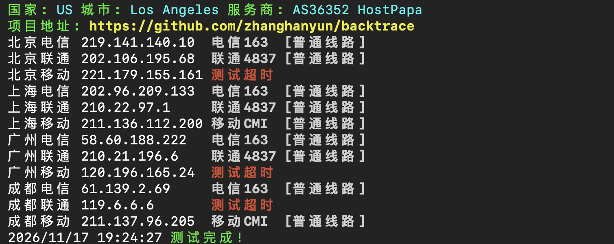
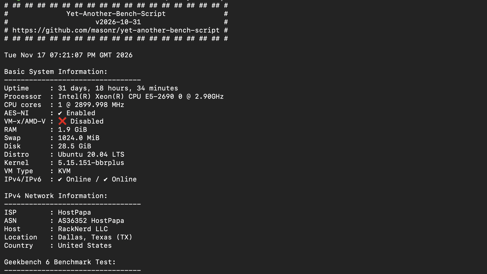

## 方案

用docker-compose 安装trojan-go，然后证书在主机申请，挂载到容器内部，然后同步

## docker-compose 文件 ，网路还是bridge ，安全考虑不使用host，内部用443 ，外部用8443，防止ddos
```
version: "3.3"

services:

  mariadb:
    image: mariadb:10.2
    container_name: trojan-mariadb
    restart: always
    environment:
      MYSQL_ROOT_PASSWORD: trojan
      MYSQL_ROOT_HOST: "%"
      MYSQL_DATABASE: trojan
    volumes:
      - ./mariadb:/var/lib/mysql
    ports:
      - "3306:3306"   # 如果你不想暴露端口，可以删掉
    networks:
      - trojan-net

  trojan:
    image: jrohy/trojan
    container_name: trojan
    restart: always
    privileged: true
    volumes:
      - ./trojan:/etc/trojan
      - ./certs:/usr/local/etc/trojan/cert
    networks:
      - trojan-net
    ports:
      - "8843:443"
      - "8080:80"
    entrypoint: ["init"]
    tty: true

networks:
  trojan-net:
    driver: bridge
```

## dns手动模式申请证书
```
acme.sh --issue -d example.com --dns \
 --yes-I-know-dns-manual-mode-enough-go-ahead-please
```

通配符证书需要两个txt记录,验证
```
dig txt _acme-challenge.example.com
```
等dns 的txt记录生效以后
```
acme.sh --renew -d example.com -d '*.example.com' --dns --yes-I-know-dns-manual-mode-enough-go-ahead-please
```

## trojan web 继承trojan和trojan-go
https://github.com/Jrohy/trojan


docker-compose 文件挂载了 volume 
主机文件系统会自动生成目录


## trojan-web 最新docker-compose版本使用教程

```
mdkir trojan_docker
```

这里我们为了网络安全起见，使用bridge模式，使用网络映射，然后把证书放在主机，挂载同步到容器，方便
后续的更新，然后容器内部用443标准端口，外部用8843非标端口，保护安全，同时开放一个外部的web管理端口
8080:80,下面是docker-compose.yml,把你生成的证书放到docker_trojan/certs
```
version: "3.3"

services:

  mariadb:
    image: mariadb:10.2
    container_name: trojan-mariadb
    restart: always
    environment:
      MYSQL_ROOT_PASSWORD: trojan
      MYSQL_ROOT_HOST: "%"
      MYSQL_DATABASE: trojan
    volumes:
      - ./mariadb:/var/lib/mysql
    ports:
      - "3306:3306"   # 如果你不想暴露端口，可以删掉
    networks:
      - trojan-net

  trojan:
    image: jrohy/trojan
    container_name: trojan
    restart: always
    privileged: true
    volumes:
      - ./trojan:/etc/trojan
      - ./certs:/usr/local/etc/trojan/cert
    networks:
      - trojan-net
    ports:
      - "8843:443"
      - "8080:80"
    entrypoint: ["init"]
    tty: true

networks:
  trojan-net:
    driver: bridge
```


然后执行
```
docker-compose/docker compose up -d
```
docker-compose或者dockers compose看你的版本使用

然后docker ps查看trojan容器
进入容器，执行以下操作，
```
docker exec -it trojan_container_id  bash
```

安装trojan


**这里显示失败正常，因为还没配置证书**


```
运行完后进入容器 docker exec -it trojan bash, 然后输入'trojan'即可进行初始化安装

启动web服务: systemctl start trojan-web

设置自启动: systemctl enable trojan-web

更新管理程序: source <(curl -sL https://git.io/trojan-install)
```


## 注意： 证书过期不影响，但是必须要证书的，因为trojan-go 是基于证书的，没有证书就无法启动

请输入证书的cert文件路径: /usr/local/etc/trojan/cert/fullchain.cer
请输入证书的key文件路径: /usr/local/etc/trojan/cert/private.key


2026/3/4 运维日记

改端口，需要修改docker-compose.yml ，然后重启容器
修改了账户密码，
客户端允许不安全连接，需要在客户端配置中添加
```
"allow_insecure": true,
```