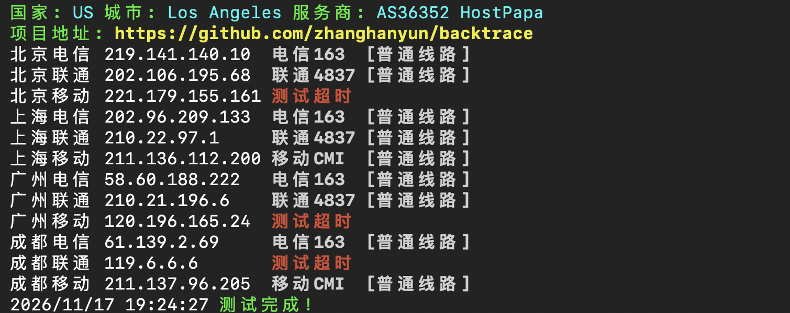
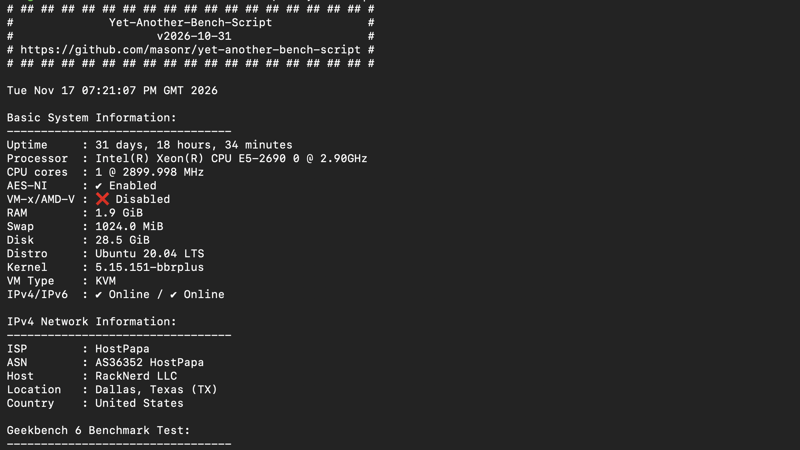

## vps 测试性能和网络

### 网络测试，国际路线问题

```
curl https://raw.githubusercontent.com/zhanghanyun/backtrace/main/install.sh -sSf | sh
```



### cpu跑分 单核高于1500为及格
```
curl -sL https://yabs.sh | bash -s -- -fi
```
